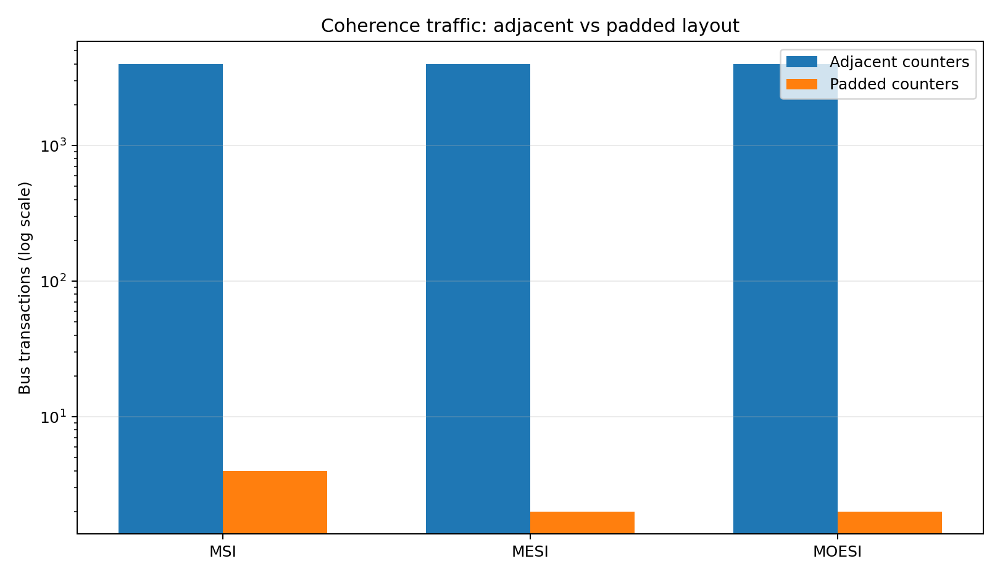
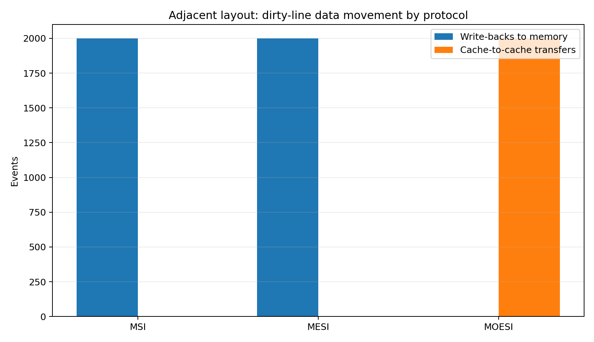
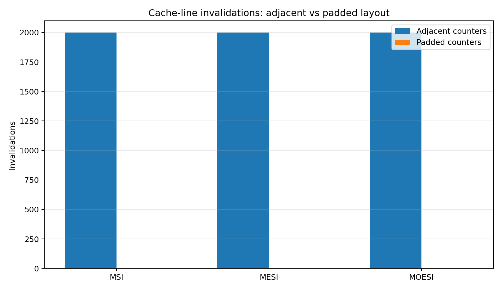

# Experiment 4: Cache Coherence (MSI, MESI, MOESI) and NUMA Memory Access

- **Course:** Parallel & Distributed / GPU Computing Laboratory
- **Experiment:** 4
- **Target OS:** Ubuntu 22.04 LTS (VMware / Linux)
- **Compiler:** GCC with OpenMP (`libgomp`)
- **Additional tools:** Python 3, `numactl`, `hwloc`
- **Workload:** Two-counter false-sharing test, protocol simulation, and NUMA memory sweep

---

## 1. Objective

To study how cache coherence protocols (**MSI, MESI and MOESI**) keep the caches of a multi-core processor consistent, and to evaluate the performance effects of coherence traffic (false sharing) and NUMA memory placement (local versus remote memory).

The experiment uses two threads, each incrementing its own counter. The counters are placed either on the same cache line or on separate cache lines. Correctness, execution time and scalability are evaluated as the number of threads increases.

## 2. Theory

### 2.1 Why cache coherence is needed

Each core in a multi-core processor may have a private cache. If two cores cache the same memory location and one core writes to it, another core's copy can become stale. A coherence protocol coordinates these copies so that the cores observe a consistent value.

### 2.2 Cache lines and false sharing

Coherence is maintained at cache-line granularity (commonly 64 bytes), not at individual-variable granularity. When independent variables written by different threads occupy the same cache line, each write can invalidate the other core's copy. The line repeatedly moves between cores. This is **false sharing**: the program remains logically correct, but performance and scalability can degrade.

Padding or alignment can place each thread's data on a separate cache line and avoid this unnecessary sharing.

### 2.3 MSI, MESI and MOESI

| State | Meaning | Memory up to date? | Other caches may hold it? |
|:---:|---|:---:|:---:|
| **M – Modified** | Only valid copy; dirty | No | No |
| **O – Owned** (MOESI) | Dirty owner supplies data to sharers | No | Yes, as Shared |
| **E – Exclusive** (MESI/MOESI) | Only copy; clean | Yes | No |
| **S – Shared** | Clean copy, possibly held by several caches | Yes, or owner has newer data | Yes |
| **I – Invalid** | Copy is not valid | — | — |

- **MSI:** Uses Modified, Shared and Invalid. A write to a shared line requires an upgrade; a write miss requests ownership.
- **MESI:** Adds Exclusive. A private clean line can transition from Exclusive to Modified on a write without another bus transaction.
- **MOESI:** Adds Owned. The owner can supply a dirty line directly to another cache, avoiding an immediate write-back to memory.

The experiment simulates these protocols because a normal CPU does not let a program switch its hardware coherence protocol at runtime.

### 2.4 NUMA (Non-Uniform Memory Access)

In a NUMA system, memory is associated with nodes. Access to memory attached to the local node is generally faster than access to memory attached to another node. Linux commonly uses a first-touch policy: the node of the thread that first writes a page influences its placement. `numactl` can bind CPU execution and memory allocation to selected nodes.

A single-socket computer or virtual machine may expose limited or virtual NUMA topology; in that case, a clear remote-memory penalty may not appear. The supplied screenshots also show a NUMA binding command rejected because a requested node was outside the available range in that run. Use the node IDs actually reported by `numactl --hardware`.

## 3. Repository Structure

```text
PGC-EXP4-CACHE-COHERENCE-NUMA/
├── README.md
├── coherence_sim.py
├── false_sharing.c
├── numa_sweep.c
├── compare_numa.c
└── screenshots/
    ├── Screenshot from 2026-11-05 15-19-31.png
    ├── Screenshot from 2026-11-05 15-19-42.png
    ├── Screenshot from 2026-11-05 15-19-51.png
    ├── Screenshot from 2026-11-05 15-19-57.png
    ├── Screenshot from 2026-11-05 15-20-05.png
    ├── Screenshot from 2026-11-05 15-20-09.png
    ├── Screenshot from 2026-11-05 15-20-16.png
    └── Screenshot from 2026-11-05 15-20-21.png
```

## 4. Software Installation

On Ubuntu, update the package index and install the required tools:

```bash
sudo apt update
sudo apt install build-essential numactl hwloc python3 -y
```

Verify the compiler and OpenMP support:

```bash
gcc --version
echo '#include <omp.h>' | gcc -E -fopenmp -xc - > /dev/null && echo "OpenMP OK"
python3 --version
numactl --hardware
lscpu | grep -E "Socket|Core|Thread|NUMA"
lscpu -e
```

Record the NUMA node IDs and CPU numbers shown on your machine before attempting node binding.

## 5. Programs and Compilation

### 5.1 Program 1 — MSI / MESI / MOESI protocol simulator

`coherence_sim.py` models two cores and a sequence of reads and writes to two counters. The adjacent layout maps both counters to cache line A; the padded layout maps them to separate lines A and B. The simulator prints a short state trace and counts bus transactions, invalidations, write-backs and cache-to-cache transfers.

Run:

```bash
python3 coherence_sim.py 1000
```

The argument is the number of iterations. If omitted, it defaults to 1000.

### 5.2 Program 2 — False sharing (adjacent versus padded)

`false_sharing.c` runs a fixed total of 100,000,000 increments. Adjacent counters use a stride of one `long`; padded counters use eight `long` values (64 bytes) between thread counters.

Compile:

```bash
gcc -O2 false_sharing.c -fopenmp -o false_sharing
```

Run with two threads:

```bash
OMP_NUM_THREADS=2 ./false_sharing adjacent
OMP_NUM_THREADS=2 ./false_sharing padded
```

The program prints the layout, thread count, final total and elapsed time. A correct run should report a total of `100000000` for both layouts.

### 5.3 Program 3 — NUMA memory sweep

`numa_sweep.c` allocates a buffer, initializes it using `memset` (first touch), and performs four read passes, sampling one byte per 64-byte cache line.

Compile:

```bash
gcc -O2 numa_sweep.c -fopenmp -o numa_sweep
```

Run a 512 MB sweep:

```bash
OMP_NUM_THREADS=2 ./numa_sweep 512
```

The memory size in MB can be supplied as the first argument. Reduce it (for example, to `128`) if the machine does not have enough available RAM.

### 5.4 Program 4 — Combined comparison benchmark

`compare_numa.c` combines the adjacent/padded counter test for 1, 2 and 4 threads with a 512 MB memory sweep for 1 and 2 threads.

Compile and run:

```bash
gcc -O2 compare_numa.c -fopenmp -o compare_numa
./compare_numa
```

The program prints two tables: false-sharing correctness and timing, followed by memory-sweep timing. Timing values are machine-dependent.

## 6. NUMA Execution

First inspect the available nodes:

```bash
numactl --hardware
```

If nodes `0` and `1` are both listed as valid memory nodes, compare local and remote placement:

```bash
OMP_NUM_THREADS=2 numactl --cpunodebind=0 --membind=0 ./numa_sweep 512
OMP_NUM_THREADS=2 numactl --cpunodebind=0 --membind=1 ./numa_sweep 512
```

You can also run the combined benchmark under the same policies:

```bash
numactl --cpunodebind=0 --membind=0 ./compare_numa
numactl --cpunodebind=0 --membind=1 ./compare_numa
```

**Important:** Do not assume that node `1` exists. If `numactl` reports only node `0`, a node-1 binding will fail. In that situation, record the topology limitation and run the false-sharing and protocol-simulation parts. A virtual NUMA topology may not represent physically remote memory.

## 7. Complete Execution Sequence

From the project directory:

```bash
# Install dependencies (one-time setup)
sudo apt update
sudo apt install build-essential numactl hwloc python3 -y

# Inspect CPU and NUMA topology
numactl --hardware
lscpu -e

# Part A: coherence protocol simulation
python3 coherence_sim.py 1000

# Part B: compile the C programs
gcc -O2 false_sharing.c -fopenmp -o false_sharing
gcc -O2 numa_sweep.c -fopenmp -o numa_sweep
gcc -O2 compare_numa.c -fopenmp -o compare_numa

# Part C: false-sharing comparison
OMP_NUM_THREADS=2 ./false_sharing adjacent
OMP_NUM_THREADS=2 ./false_sharing padded

# Part D: combined comparison
./compare_numa

# Part E: NUMA placement (only if the listed node IDs are valid)
OMP_NUM_THREADS=2 numactl --cpunodebind=0 --membind=0 ./numa_sweep 512
OMP_NUM_THREADS=2 numactl --cpunodebind=0 --membind=1 ./numa_sweep 512
```

For repeatable measurements, close unnecessary applications, run each configuration several times, and compare the median rather than relying on a single timing. Use the same workload and thread count when comparing layouts or placement policies.

## 8. Experimental Screenshots

The following screenshots were supplied with the experiment archive. They are retained in the `screenshots/` directory as execution evidence.

### 8.1 CPU and NUMA topology


### 8.2 Protocol simulator output


### 8.3 False-sharing and comparison benchmark


### 8.4 NUMA binding attempt and command output


> The screenshots include both successful program output and troubleshooting attempts. In particular, a `numactl` invocation reports an invalid node argument. This is retained as captured evidence; use the actual node list on the target machine when repeating the NUMA test.

## 9. Expected Output and Results to Record

### 9.1 Protocol simulation

For the adjacent layout, both cores access the same cache line, so ownership repeatedly moves between them. For the padded layout, each core accesses a different line and the repeated invalidation traffic is avoided.

The simulator reports the following categories:

| Counter | Meaning |
|---|---|
| `BusRd` | Read request on the bus |
| `BusRdX` | Read-for-ownership request |
| `BusUpgr` | Upgrade from shared ownership |
| `invalidations` | Copies invalidated in other caches |
| `writeback` | Dirty data written back to memory |
| `c2c` | Cache-to-cache data transfer |
| `silent E->M` | Exclusive-to-Modified transition without bus traffic |

### 9.2 False-sharing benchmark

The combined program prints this table format:

```text
Table 1: false sharing (100000000 increments in total)
Layout   | Threads | Final Count | Correctness | Time (s)
---------------------------------------------------------
adjacent |       1 |   100000000 | Correct     |  measured
padded   |       1 |   100000000 | Correct     |  measured
adjacent |       2 |   100000000 | Correct     |  measured
padded   |       2 |   100000000 | Correct     |  measured
adjacent |       4 |   100000000 | Correct     |  measured
padded   |       4 |   100000000 | Correct     |  measured
```

### 9.3 NUMA memory sweep

The combined benchmark reports the elapsed time for a 512 MB buffer over four passes with one and two threads. For a valid local-versus-remote comparison, run under valid CPU and memory node bindings and record the actual timings.

Record these values from your own machine:

| Configuration | Time (s) |
|---|---:|
| Adjacent counters, 2 threads | |
| Padded counters, 2 threads | |
| Local memory, 1 thread | |
| Local memory, 2 threads | |
| Remote memory, 1 thread | |
| Remote memory, 2 threads | |

Useful ratios:

- **False-sharing cost:** adjacent time / padded time
- **NUMA placement cost:** remote time / local time

Do not copy timing values from another machine: CPU model, virtualisation, memory size, thread placement and system load all affect results.

## 10. Observation and Comparison

| Case | Correctness | Relative performance / observation |
|---|---|---|
| MSI | Correct | A private line needs an upgrade before its first write. |
| MESI | Correct | Exclusive-to-Modified transition avoids the upgrade for private data. |
| MOESI | Correct | Owned state can supply dirty data to another cache without an immediate memory write-back. |
| Adjacent counters | Correct | False sharing can make the cache line bounce between cores. |
| Padded counters | Correct | Separate cache lines avoid false sharing between the counters. |
| Local NUMA memory | Correct | Baseline memory-sweep time for the selected node. |
| Remote NUMA memory | Correct | Typically slower on a genuinely multi-socket system; may be similar on a single-socket VM. |

## 11. Comparison Graphs

The graphs below are generated from the included `coherence_sim.py` simulator using **1,000 iterations** of its two-core workload. They visualize simulated coherence-event counts, not wall-clock benchmark timings from a physical CPU. Actual execution-time graphs should be generated from measurements collected on the target machine; no timing values are fabricated here.

### 11.1 Bus transactions: adjacent versus padded counters



The adjacent layout repeatedly transfers ownership of the same cache line and therefore generates thousands of bus transactions in this model. Padding the counters onto separate lines sharply reduces this traffic. The y-axis is logarithmic so that both layouts remain visible.

### 11.2 Dirty data movement: write-back versus cache-to-cache transfer



For the adjacent layout, MSI and MESI account for dirty-line write-backs in this simulator, while MOESI uses the Owned state and records cache-to-cache transfers instead. This graph illustrates the protocol distinction described in the theory section.

### 11.3 Cache-line invalidations



Invalidations occur repeatedly when the counters share a cache line. The padded layout eliminates these invalidations in the modeled workload because the two cores operate on different lines.

> **Interpretation note:** These are protocol-simulator counts from the supplied workload and implementation. They are not measurements of a processor's internal bus or interconnect. For a report comparing real execution performance, record the `Time (s)` values printed by `compare_numa` on your own system and plot those separately.

## 12. Conclusion

The experiment studies cache consistency through MSI, MESI and MOESI simulation and connects protocol behaviour to real parallel-program performance. The simulator illustrates the additional coherence traffic caused when independent counters share one cache line. Padding separates the counters and reduces this false-sharing effect. The NUMA sweep demonstrates how memory placement can influence access time when a system has genuinely distinct memory nodes.

The results should be interpreted together with the machine's topology. The supplied screenshots show that the NUMA binding attempt for a requested node was rejected in that environment, so a valid remote-memory measurement must only be claimed after confirming that the requested node exists and the command completes successfully.

---

## 13. Notes on Source Code

The C and Python programs in this repository are provided as separate, directly compilable/runnable files. The source PDF's code snippets have been transcribed into these files, with small formatting/completeness repairs where the extracted listing was visibly truncated (including the final statistics-key list in the Python appendix). The experiment's intended workload, protocol concepts, buffer sizes and command-line workflow are preserved.
